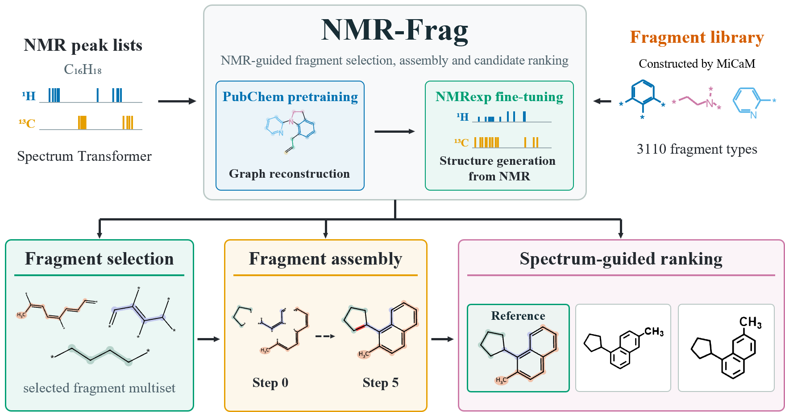

# NMR-Frag

Molecular structure elucidation from one-dimensional NMR spectra by fragment selection and assembly. NMR-Frag selects a multiset of fragments, connects their attachment points and ranks the resulting 2D structures against the input spectrum.



[Data and checkpoints](#data-and-checkpoints) · [Checkpoint verification](#checkpoint-verification) · [Dataset preparation](#dataset-preparation) · [Training](#training) · [Evaluation](#evaluation)

## Data and checkpoints

Run all commands from the repository root. The GitHub layout contains `src/`, `data/`, `images/` and this README. Put datasets, checkpoints and run outputs under `data/`.

| Local path | Contents | Needed for |
| --- | --- | --- |
| `data/checkpoints/nmrexp/last.pt` | A trained NMRexp checkpoint. An existing `best.pt` can also be supplied by its own path. | Spectrum evaluation and offline hard-negative mining |
| `data/checkpoints/pubchem/last.pt` | A PubChem reconstruction checkpoint | Starting NMRexp training from existing PubChem weights |
| `data/processed/overall_3000/` | Original processed dataset with `manifest.json`, `tokenizer.json`, `catalog.pt` and partitioned `examples/` | Evaluation, mining and PubChem training |
| `data/processed/overall_3000_hard_candidates/` | Same layout with per-record candidate graphs in the NMRexp partitions | Main NMRexp training and evaluation |
| `data/processed/fragments/tokenizer.json` | Complete fragment vocabulary and merge rules associated with an existing checkpoint | Rebuilding examples for that checkpoint from raw data |
| `data/raw/NMRexp/` | One NMRexp release or one set of split files, in Parquet, LMDB, JSONL or CSV format | Building from raw spectra. [NMRexp dataset](https://zenodo.org/records/17296666) |
| `data/raw/PubChem/CID-SMILES.gz` | Two columns, PubChem CID and SMILES, separated by whitespace | Building from raw structures. [PubChem CID–SMILES](https://ftp.ncbi.nlm.nih.gov/pubchem/Compound/Extras/CID-SMILES.gz) |

For an existing run, use its processed dataset, or rebuild examples with its original `tokenizer.json`, heavy-atom limit and split assignments. The loader checks the vocabulary SHA-256, the catalog identity, the heavy-atom limit and every model parameter. Checkpoints from `src_v6_cosine` use format `v6-cosine-ce-1`. A vocabulary rebuilt independently can have the same size and different fragment IDs.

### Installation

Use a Python 3.11 or 3.12 environment. The dependency versions used in CPU compatibility checks are pinned in `src/requirements.txt`. For GPU runs, install the PyTorch 2.6.0 build for your CUDA environment, then install the remaining requirements.

```bash
python -m pip install -r src/requirements.txt
```

## Checkpoint verification

With an existing NMRexp checkpoint and its processed dataset, generate candidates for one validation record. Set `--data` to the local dataset path when moving a checkpoint to another machine. Either processed layout in the table works for evaluation.

```bash
python src/05_evaluate.py --stage nmrexp --split valid \
  --checkpoint data/checkpoints/nmrexp/last.pt \
  --data data/processed/overall_3000 --limit 1 \
  --out data/evaluation/checkpoint_check.jsonl --device cpu --threads 1
```

A completed run writes the checkpoint hash, resolved settings, predictions and metrics. To check a PubChem checkpoint, use `--stage pubchem`, its checkpoint path and a separate output path.

## Dataset preparation

### 1. Standardize records and assign splits

```bash
python src/01_prepare_data.py --nmrexp data/raw/NMRexp \
  --pubchem data/raw/PubChem/CID-SMILES.gz --out data/processed/uniform \
  --cid-mod 100 --max-heavy 100 --seed 42
```

Raw NMRexp nucleus records use `SMILES`, `NMR_type` and `NMR_processed`. Paired records can supply `smiles`, `h_peaks` and `c_peaks`. Point `--nmrexp` directly at one file if the download directory also contains alternate exports. Supply the original benchmark split with `--split-file data/raw/splits.csv` (columns `smiles,split`), or use split labels in the records or filenames. Unassigned molecules receive a seeded 85.5% / 4.5% / 10% train/valid/test split. PubChem pretraining excludes NMRexp validation and test structures. The PubChem example selects CIDs divisible by 100. Recreating a specific benchmark cohort requires its original split assignments and data snapshots.

### 2. Build or reuse the fragment vocabulary

To generate a new vocabulary, fit the merge rules on training structures and retain up to 3,000 frequent fragment tokens in addition to the atomic fallback templates.

```bash
python src/02_build_fragments.py --data data/processed/uniform \
  --out data/processed/fragments --top-k 3000 --min-count 1000 \
  --merges 256 --mine-per-source 5000 --max-atoms 12
```

When using existing weights, place their original `tokenizer.json` in `data/processed/fragments/` and go directly to step 3.

### 3. Encode and verify the training examples

```bash
python src/03_prepare_data.py --data data/processed/uniform \
  --fragments data/processed/fragments --out data/processed/overall_3000 \
  --hard-negatives 2
```

This writes the fragment labels, attachment-point connections, graph features and up to two local negatives from bond rewiring. It checks that each reference decomposition reconstructs the original 2D structure. Use new output directories for data construction. A complete existing processed dataset can be used directly at the corresponding training or evaluation step.

## Training

### PubChem pretraining

```bash
python src/04_train.py --stage pubchem --data data/processed/overall_3000 \
  --run-dir data/runs/pubchem --fragment-repr hybrid --epochs 20 \
  --batch-size 64 --tasks-per-record 2 --lr 2e-4 --seed 42 --device cuda:0
```

### Prepare and merge hard negatives with an existing NMRexp checkpoint

Mine candidates from NMRexp **train** using a trained spectrum-conditioned checkpoint and the original step-03 data. Pass `--limit 0` for all eligible training molecules or a positive limit for a smaller run.

```bash
python src/07_prepare_hard_negatives.py --checkpoint data/checkpoints/nmrexp/last.pt \
  --data data/processed/overall_3000 --out data/hard/train.jsonl \
  --cohort available --limit 0 --max-negatives 8 --beam 32 --connect-beam 8 \
  --seed 42 --device cuda:0

python src/08_merge_hard_candidates.py --data data/processed/overall_3000 \
  --hard-cache data/hard/train.jsonl \
  --out data/processed/overall_3000_hard_candidates
```

The miner selects one spectrum per training molecule, preferring paired ¹H/¹³C records. `--cohort available` also uses single-nucleus spectra. `--cohort paired` reproduces paired-only sampling. It retains distinct, formula-matched candidates with different 2D connectivity from the target. Add `--resume` to continue an interrupted mining run or increase its molecule limit. Keep the JSONL beside its generated `.config.json`.

The merge shares a molecule's mined candidates across its training spectra. Validation and test records use only their own step-03 local negatives. The merged dataset records the mining checkpoint hash and per-split coverage in `hard_candidates_report.json`. Existing merged datasets can be used directly for fine-tuning.

<details>
<summary>Starting with a new vocabulary and no compatible NMRexp checkpoint</summary>

After PubChem pretraining, fit a seed NMRexp model using the local negatives from step 3. Use its `last.pt` as the checkpoint in step 07. The mining, merging and final fine-tuning commands then follow the same workflow. The resulting pools depend on this seed model.

```bash
python src/04_train.py --stage nmrexp --bootstrap --data data/processed/overall_3000 \
  --init-from data/runs/pubchem/last.pt --run-dir data/runs/nmrexp_seed \
  --epochs 20 --batch-size 64 --tasks-per-record 2 --lr 2e-4 \
  --lr-decay-scale 2 --rank-weight 0.5 --device cuda:0
```

</details>

### NMRexp fine-tuning

```bash
python src/04_train.py --stage nmrexp \
  --data data/processed/overall_3000_hard_candidates \
  --init-from data/runs/pubchem/last.pt --run-dir data/runs/nmrexp \
  --epochs 20 --batch-size 64 --tasks-per-record 2 --lr 2e-4 --lr-decay-scale 2 \
  --rank-weight 0.5 --hard-negatives 4 --eval-valid 500 \
  --eval-beam 32 --eval-connect-beam 8 --eval-connect-normalization pair-mask \
  --eval-score-mode joint --eval-alpha 0.5 --eval-connect-weight 0.25 \
  --eval-rank-mix 0.9 --eval-pool-size 0 --seed 42 --device cuda:0
```

For a supplied PubChem checkpoint, use `--init-from data/checkpoints/pubchem/last.pt`. For NMRexp training from scratch on the same merged data, omit `--init-from`, specify `--fragment-repr hybrid` and choose a new run directory. This run omits graph-teacher alignment. `--rank-weight` weights the training loss. `--eval-rank-mix` weights Rank during generation validation.

For the earlier epoch-selection rule, keep the example's 500 validation records and widths 32/8, and set `--eval-connect-normalization feasible --eval-score-mode stage --eval-alpha 1 --eval-connect-weight 1 --eval-rank-mix 0.7 --eval-pool-size 128`. Both settings train with the same loss.

### Resume a training run

```bash
python src/04_train.py --stage nmrexp \
  --data data/processed/overall_3000_hard_candidates \
  --resume data/runs/nmrexp/last.pt --run-dir data/runs/nmrexp \
  --epochs 25 --device cuda:0
```

`--epochs` is the total epoch count. Resume restores optimizer state and checks the original NMRexp dataset manifest. `last.pt` records the most recent epoch. With generation validation enabled, `best.pt` is selected by Hit@1, then Hit@10, then validation loss. Per-epoch and per-batch metrics are written to `metrics.csv` and `batch_metrics.csv`.

## Evaluation

Run the reference decoding configuration on the complete paired ¹H/¹³C test cohort with a molecular formula and full peak annotations. Use `--split valid` and a separate output file for validation. To evaluate supplied weights, replace the checkpoint path.

```bash
python src/05_evaluate.py --stage nmrexp --split test \
  --checkpoint data/runs/nmrexp/last.pt --data data/processed/overall_3000_hard_candidates \
  --mode hc --cohort paired --formula --annotations full --beam 64 --connect-beam 16 \
  --connect-normalization pair-mask --score-mode joint --alpha 0.5 \
  --connect-weight 0.25 --rank-mix 0.9 --pool-size 0 --limit 0 \
  --out data/evaluation/nmrexp_test.jsonl --device cuda:0
```

The reference generation score is $(A+0.25C)/\sqrt{n_A+n_C}$, where $A$ and $C$ are the cumulative Add and Connect log scores. $n_A$ counts selected fragments plus the stop action and $n_C$ counts connections. Pair-mask normalization scores each Connect choice over its allowed port partners and expands feasible continuations. Each unique structure retains its best path. The final score mixes the standardized generation score (10%) and Rank score (90%) over the full set of unique candidates. `--pool-size 0` retains that entire set.

| Evaluation setting | Standalone flags |
| --- | --- |
| Proton or carbon spectrum only | `--mode h` or `--mode c`. Use `--cohort paired` for the same molecules as the two-spectrum evaluation, or `--cohort available` for all records with the requested nucleus. |
| Shifts only or missing formula | `--annotations shift` or `--no-formula` |
| Smaller search | `--beam 32 --connect-beam 8` or `--beam 16 --connect-beam 4` |
| Generation score alone | `--rank-mix 0` |
| Given the reference fragment multiset | `--diagnostic oracle-bag` |
| Original standalone decoder settings | `--beam 32 --connect-beam 8 --connect-normalization feasible --score-mode stage --alpha 1 --connect-weight 1 --rank-mix 0.7 --pool-size 128` |

Training accepts the same spectrum and decoding options with an `--eval-` prefix, e.g. `--eval-mode h` and `--eval-rank-mix 0`. These affect per-epoch free generation and checkpoint selection. New runs default to widths 16/4 for per-epoch generation and 64/16 for standalone evaluation. A resumed training run inherits its saved decoding settings.

Predictions are written to JSONL, aggregate metrics to `.summary.json`, resolved settings to `.config.json` and cumulative metrics to `.progress.log`. Add `--resume` to continue the same evaluation. Hit@1/3/5/10 use exact canonical 2D connectivity. Tani@1/3/5/10 average each target's best ECFP4-2048 Tanimoto similarity among its top *k* distinct candidates, with zero for an empty pool. The original JSON field names are `tomi1`, `tomi3`, `tomi5` and `tomi10`. `oracle_pool` reports target inclusion anywhere in the retained candidate set.
